# Architecture

Technical documentation of the trading bot's architecture, components, and design patterns.

## Directory Structure

```
src/tradingbot/
├── __init__.py              # Public API exports
├── config.py                # Configuration management (TOML)
├── types.py                 # Core data models
├── interfaces.py            # Protocol definitions
│
├── backtest_cli.py          # tradingbot-backtest CLI
├── optimize_cli.py          # tradingbot-optimize CLI
├── cli.py                   # tradingbot-live CLI
├── cache_cli.py             # tradingbot-cache CLI
│
└── _components/             # Internal modules
    ├── bot.py               # MarketStructureBot (backtesting)
    ├── runner.py            # Backtest orchestration
    ├── optimizer.py         # Parameter optimization
    ├── execution.py         # ExecutionModel (slippage, spread, commission)
    ├── signals.py           # SignalGenerator
    ├── swing.py             # Swing point detection
    ├── risk.py              # PositionSizer
    ├── live_risk.py         # LiveRiskManager
    ├── presets.py           # Strategy presets
    │
    ├── engine/              # Real-time trading engine
    ├── feeds/               # Data feed plugins
    ├── brokers/             # Broker plugins
    ├── strategies/          # Entry/exit strategies
    ├── indicators/          # Technical indicators
    ├── cache/               # DuckDB data cache
    ├── hub/                 # Event hub + WebSocket
    └── tui/                 # Terminal UI
```

## Core Types

Defined in `types.py`:

| Type | Description |
|------|-------------|
| `Bar` | OHLCV data point with datetime |
| `Position` | Active trade state (entry, size, SL/TP) |
| `Trade` | Closed trade record with P&L (gross, net, costs) |
| `Signal` | BUY / SELL / HOLD decision |
| `ExecutionModel` | Slippage, spread, commission modeling |
| `SwingPoint` | Local high/low for structure analysis |
| `Order` | Broker order request |
| `Trend` | BULLISH / BEARISH / NEUTRAL |

## Plugin Architecture

The system uses a **registry pattern** for extensibility:

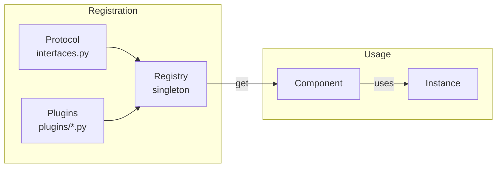

### Registries

| Registry | Plugins | Default |
|----------|---------|---------|
| **BrokerRegistry** | `paper`, `alpaca` | `paper` |
| **FeedRegistry** | `yahoo`, `alpaca`, `replay` | `yahoo` |
| **EntryRegistry** | 9 strategies | `swing_break` |
| **ExitRegistry** | `swing`, `atr`, `fixed` | `swing` |
| **IndicatorRegistry** | 11 indicators | `rsi`, `macd` |

### Adding a Plugin

```python
# src/tradingbot/_components/strategies/entry/my_strategy.py
from ..interfaces import Entry
from ..registry import register_entry

class MyStrategy:
    @property
    def name(self) -> str:
        return "my_strategy"

    def compute(self, df): ...
    def signal(self, df, idx, has_position): ...

register_entry(MyStrategy())
```

Then import in `registry.py` bootstrap function.

## Data Flow

### Backtesting Flow

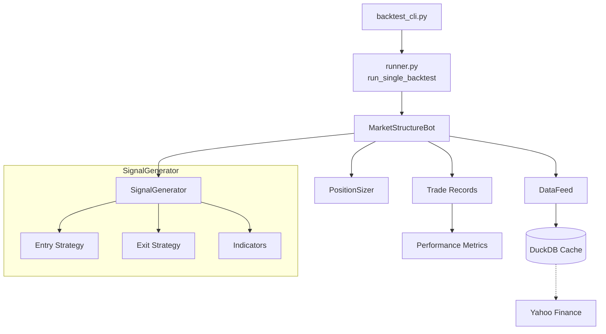

### Live Trading Flow

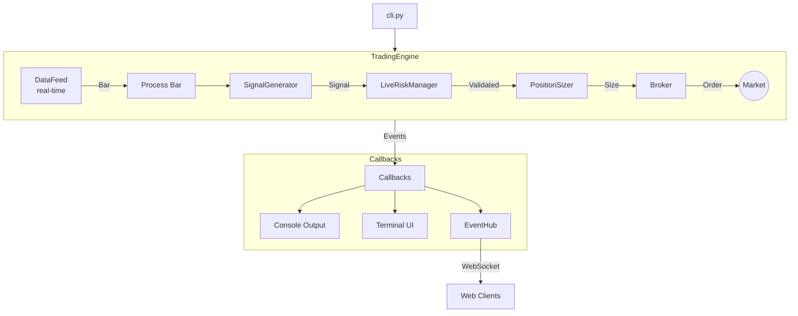

## Signal Generation

The `SignalGenerator` coordinates entry strategies, exit strategies, and indicator filters:

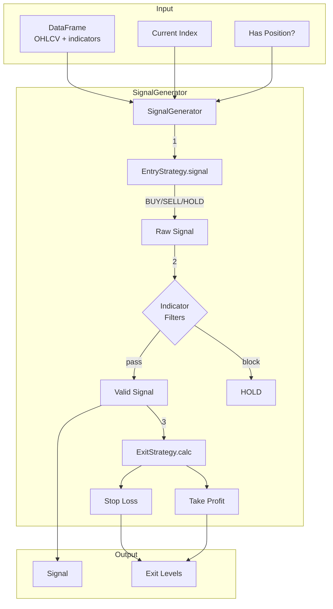

### Indicator Filter Logic

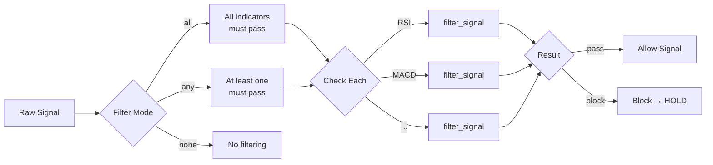

## Callback System

### Engine Callbacks

The `TradingEngine` emits events through `EngineCallbacks`:

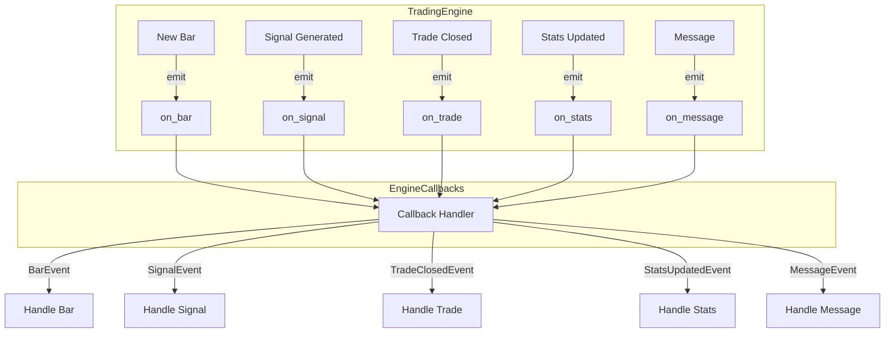

### Event Types

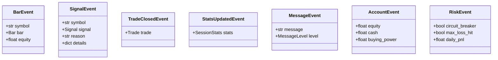

### EventHub Architecture

The `EventHub` provides centralized state management and broadcasting:

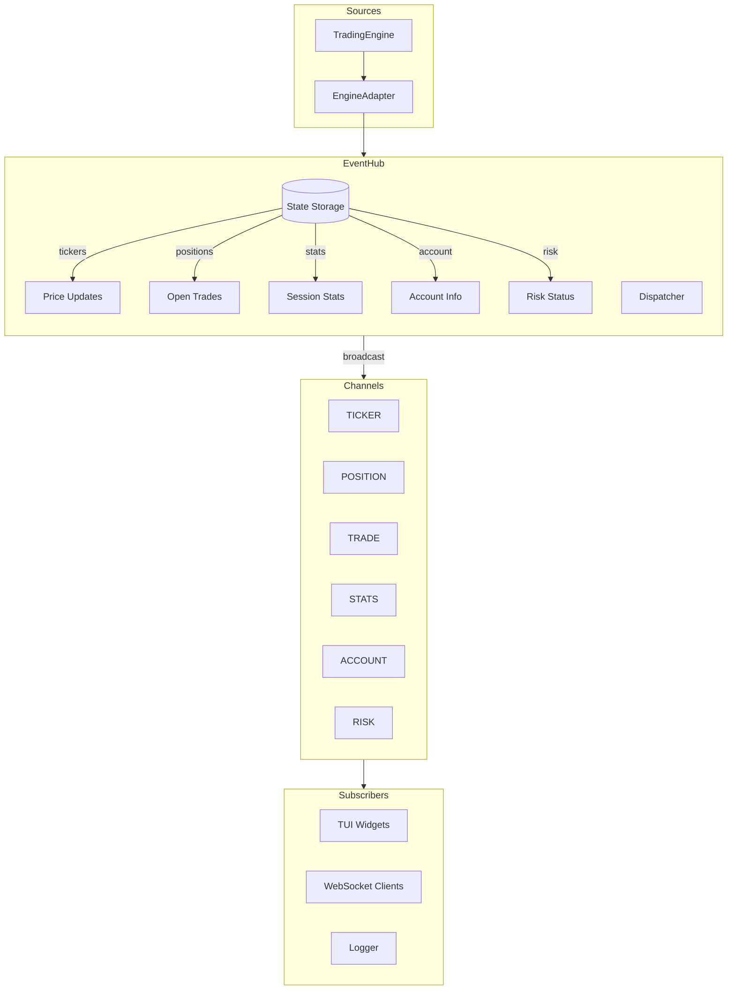

### WebSocket Message Flow

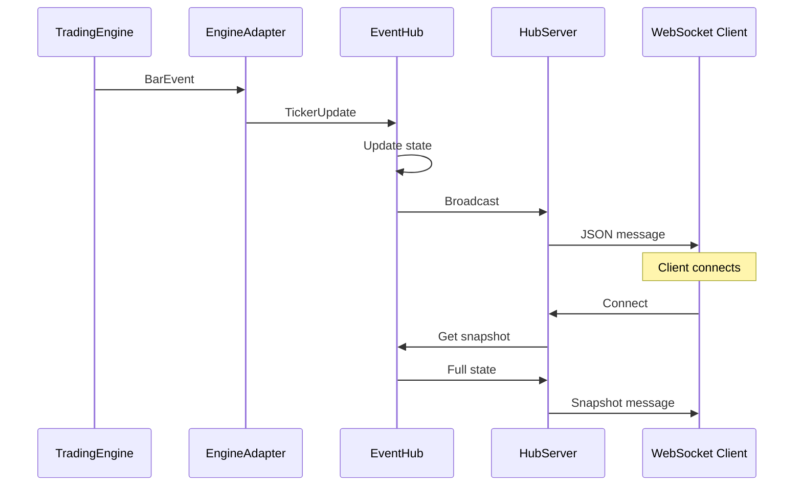

## Component Details

### TradingEngine

Event-driven engine for real-time trading:

```python
class TradingEngine:
    def __init__(
        symbols: list[str],
        broker: BrokerProtocol,
        feed: DataFeedProtocol,
        signal_generator: SignalGenerator,
        position_sizer: PositionSizer,
        live_risk_manager: LiveRiskManager,
        rr_ratio: float,
        allow_short: bool,
        dry_run: bool,
        callbacks: EngineCallbacks,
    )
```

### Engine Event Loop

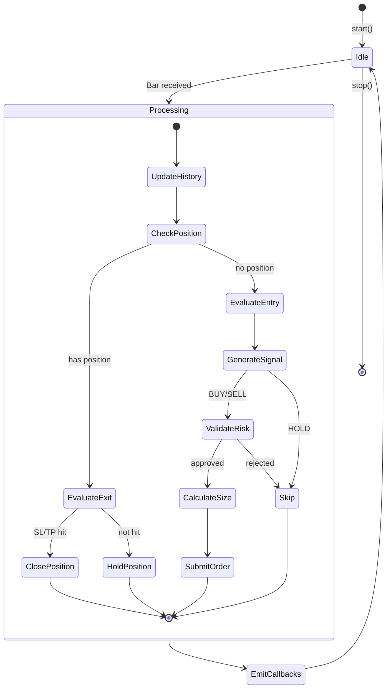

### Cache System

DuckDB-based historical data cache with aggregation and retention management:

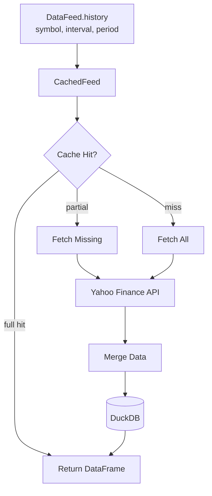

### Cache Maintenance

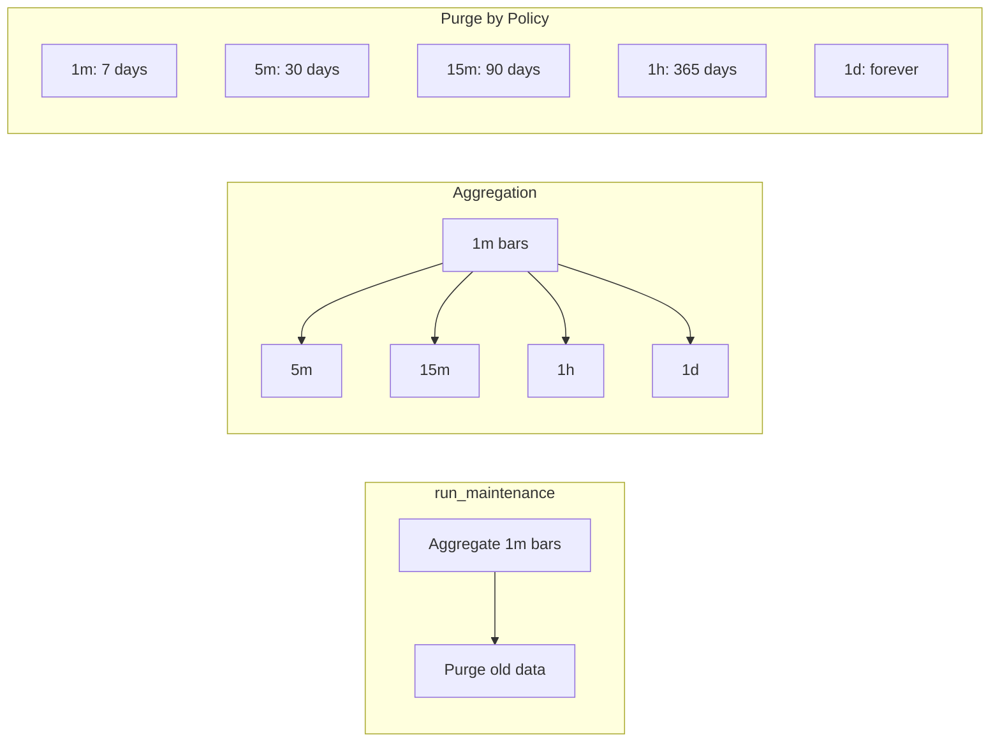

### Cache Functions

| Function | Description |
|----------|-------------|
| `insert_bars()` | Insert/upsert bars into DuckDB |
| `query_bars()` | Query bars by symbol, interval, date range |
| `aggregate_bars()` | Aggregate from source to target interval |
| `aggregate_all_intervals()` | Aggregate 1m → 5m/15m/1h/1d |
| `purge_old_bars()` | Delete bars older than retention policy |
| `run_maintenance()` | Full maintenance: aggregate + purge |

### Execution Cost Model

The `ExecutionModel` provides realistic trade execution cost simulation:

```mermaid
flowchart LR
    subgraph Entry
        SP[Signal Price] --> Spread[+ Spread/2]
        Spread --> Slip[+ Slippage]
        Slip --> EP[Entry Price]
    end

    subgraph Exit
        XP[Signal Price] --> XSpread[- Spread/2]
        XSpread --> XSlip[- Slippage]
        XSlip --> Exit[Exit Price]
    end

    subgraph Costs
        EP --> Comm[+ Commission]
        Exit --> Comm
        Comm --> Total[Total Costs]
    end
```

**Cost Components:**

| Component | Default | Description |
|-----------|---------|-------------|
| Slippage | 5 bps | Price movement between signal and fill |
| Spread | 2 bps | Bid-ask spread (pay ask, sell bid) |
| Commission | $0.005/share | Per-share brokerage fee |

**P&L Calculation:**

```python
# LONG trade example
entry_price = signal_price * (1 + spread_bps/20000 + slippage_bps/10000)
exit_price = signal_price * (1 - spread_bps/20000 - slippage_bps/10000)
gross_pnl = (exit_signal - entry_signal) * shares
commission = shares * commission_per_share * 2  # round-trip
net_pnl = (exit_price - entry_price) * shares - commission
```

**Factory Methods:**

| Method | Use Case |
|--------|----------|
| `ExecutionModel()` | Default costs (5bps slip, 2bps spread, $0.005 comm) |
| `ExecutionModel.zero()` | No costs (for comparison/benchmarking) |
| `ExecutionModel.conservative()` | Higher costs (10bps slip, 5bps spread) |

**CLI Flags:**

```bash
tradingbot-backtest AAPL --no-costs           # Disable all costs
tradingbot-backtest AAPL --slippage 10        # Custom slippage (bps)
tradingbot-backtest AAPL --spread 5           # Custom spread (bps)
tradingbot-backtest AAPL --commission 0.01    # Custom commission ($/share)
```

**Retention Policy:**
| Interval | Default Retention |
|----------|-------------------|
| 1m | 7 days |
| 5m | 30 days |
| 15m | 90 days |
| 1h | 365 days |
| 1d | Forever |

## Configuration

Hierarchy (later overrides earlier):

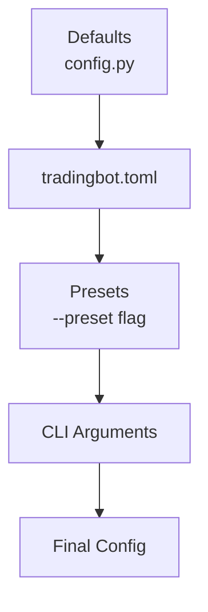

### Config Sections

```toml
[tradingbot.strategy]      # Entry/exit, risk params
[tradingbot.bot]           # Capital
[tradingbot.engine]        # Broker, feed, bar interval
[tradingbot.engine.risk]   # Live risk controls
[tradingbot.cache]         # Cache settings
```

## Protocols (Interfaces)

Defined in `interfaces.py`:

### BrokerProtocol

```python
class BrokerProtocol(Protocol):
    async def connect(self) -> None
    async def disconnect(self) -> None
    async def submit_order(self, order: Order) -> OrderResult
    async def cancel_order(self, order_id: str) -> bool
    async def get_position(self, symbol: str) -> Position | None
    async def get_account(self) -> AccountInfo
```

### DataFeedProtocol

```python
class DataFeedProtocol(Protocol):
    async def connect(self) -> None
    async def disconnect(self) -> None
    async def subscribe(self, symbols: list[str]) -> None
    def on_bar(self, callback: Callable[[Bar], None]) -> None
    def history(self, symbol, interval, period) -> pl.DataFrame
```

### EntryStrategy

```python
class EntryStrategy(Protocol):
    @property
    def name(self) -> str: ...
    def compute(self, df: pl.DataFrame) -> pl.DataFrame: ...
    def signal(self, df, idx, has_position) -> Entry: ...
```

### ExitStrategy

```python
class ExitStrategy(Protocol):
    @property
    def name(self) -> str: ...
    def calc(self, direction, entry, df, swings, rr_ratio) -> Exit: ...
```

### IndicatorProtocol

```python
class IndicatorProtocol(Protocol):
    @property
    def name(self) -> str: ...
    def compute(self, df: pl.DataFrame) -> pl.DataFrame: ...
    def get_signal(self, df, idx) -> Signal | None: ...
    def filter_signal(self, signal, df, idx) -> bool: ...
```

## Design Patterns

| Pattern | Usage |
|---------|-------|
| **Registry** | Plugin discovery and access |
| **Singleton** | Registry instances |
| **Strategy** | Entry/exit/indicator algorithms |
| **Adapter** | EngineAdapter (engine → hub) |
| **Observer** | Callbacks, hub subscriptions |
| **Protocol** | Interface definitions |
| **Dataclass** | Immutable config objects |

## Entry Points

| Command | Module | Description |
|---------|--------|-------------|
| `tradingbot-backtest` | `backtest_cli.py` | Run backtests |
| `tradingbot-optimize` | `optimize_cli.py` | Parameter optimization |
| `tradingbot-live` | `cli.py` | Live/paper trading |
| `tradingbot-cache` | `cache_cli.py` | Cache management |

## Testing

```bash
task test          # Run all tests
task check         # Lint + typecheck + test
```

Test organization:
```
tests/
├── test_bot.py           # Backtest logic
├── test_signals.py       # Signal generation
├── test_swing.py         # Swing detection
├── test_indicators.py    # Indicator calculations
├── test_risk.py          # Position sizing, risk
├── test_execution.py     # Execution cost modeling
├── test_alpaca_broker.py # Broker integration
├── test_alpaca_feed.py   # Feed integration
└── test_models.py        # Data models
```
